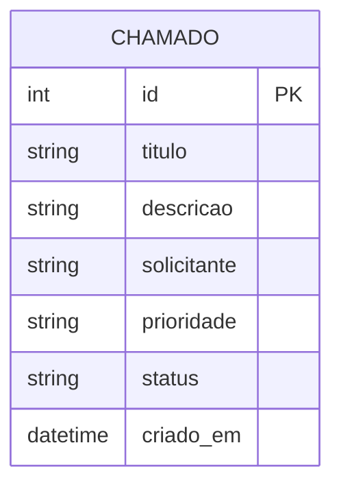

# Projeto de Dados: Help Desk

## 1. Modelo conceitual (DER da versão implementada)

A versão entregue possui apenas a entidade CHAMADO. O solicitante é um atributo textual, não uma entidade independente.



Uma tabela SOLICITANTE independente seria uma **possível evolução futura**, mas não faz parte do banco nem do código entregue.

## 2. Modelo lógico normalizado
**Versão implementada:** `chamado(id, titulo, descricao, solicitante, prioridade, status, criado_em)`
- 1FN: atributos atômicos, sem grupos repetidos.
- 2FN: chave simples (`id`), sem dependência parcial.
- 3FN: nenhum atributo não-chave depende de outro não-chave. `solicitante` é guardado como texto para simplificar.

**Evolução (se houver login):** `solicitante(id PK, nome)` e `chamado(..., solicitante_id FK → solicitante.id)`. Isso evita repetir o nome do solicitante em cada chamado.

## 3. Projeto físico
```sql
CREATE TABLE chamado (
    id          INTEGER PRIMARY KEY AUTOINCREMENT,
    titulo      VARCHAR(100) NOT NULL CHECK (length(trim(titulo)) BETWEEN 1 AND 100),
    descricao   TEXT NOT NULL CHECK (length(trim(descricao)) BETWEEN 1 AND 2000),
    solicitante VARCHAR(80) NOT NULL CHECK (length(trim(solicitante)) BETWEEN 1 AND 80),
    prioridade  VARCHAR(10) NOT NULL CHECK (prioridade IN ('baixa','media','alta')),
    status      VARCHAR(15) NOT NULL DEFAULT 'aberto'
                CHECK (status IN ('aberto','em_andamento','resolvido')),
    criado_em   DATETIME NOT NULL DEFAULT CURRENT_TIMESTAMP
);
```

## 4. Dicionário de dados
| Coluna | Tipo | Nulo | Domínio / regra | Descrição |
|---|---|---|---|---|
| id | INTEGER | não | PK, autoincremento | Identificador do chamado |
| titulo | VARCHAR(100) | não | texto não vazio | Resumo do problema |
| descricao | TEXT | não | 1 a 2000 caracteres | Detalhes do problema |
| solicitante | VARCHAR(80) | não | texto não vazio | Quem abriu o chamado |
| prioridade | VARCHAR(10) | não | {baixa, media, alta} | Urgência |
| status | VARCHAR(15) | não | {aberto, em_andamento, resolvido}; padrão `aberto` | Situação atual |
| criado_em | DATETIME | não | padrão `CURRENT_TIMESTAMP` | Data e hora de abertura |

## 5. Integridade
Domínios garantidos por `CHECK` no banco e por `models.validar()` na aplicação (dupla proteção).
