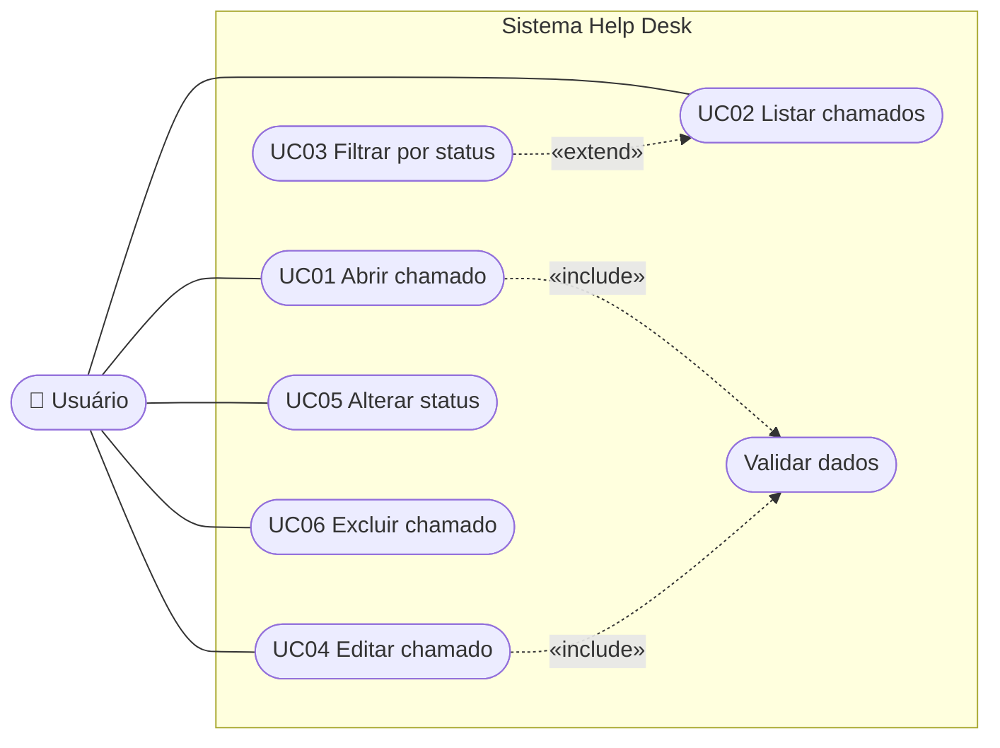
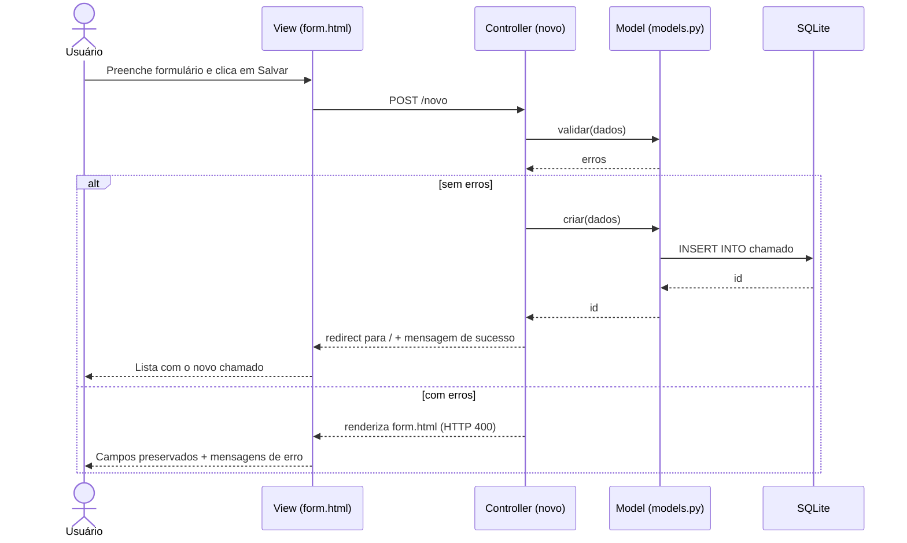
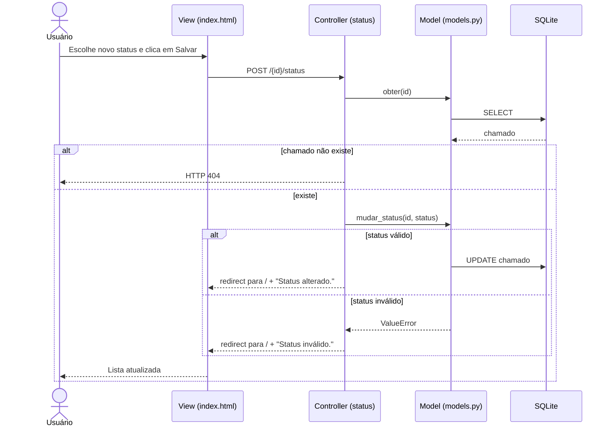

# Help Desk: Casos de Uso e Diagramas de Sequência

## 1. Diagrama de casos de uso

Ator: **Usuário** (solicitante e atendente). Os diagramas usam Mermaid e renderizam direto no GitHub.

### Especificação resumida

| Caso de uso | Fluxo principal | Fluxo alternativo / exceção |
|---|---|---|
| UC01 Abrir chamado | Usuário preenche título, descrição, solicitante e prioridade; o sistema valida, grava com status `aberto` e exibe confirmação | Dados inválidos: o sistema mantém o formulário preenchido e mostra o erro em cada campo |
| UC02 Listar chamados | O sistema exibe os chamados do mais novo ao mais antigo, com cor por prioridade | Sem chamados: mensagem "Nenhum chamado encontrado" |
| UC03 Filtrar por status | Usuário escolhe `aberto`, `em andamento` ou `resolvido` | Status desconhecido: lista todos |
| UC04 Editar chamado | Usuário altera os campos; o sistema valida e salva | Chamado inexistente: erro 404 |
| UC05 Alterar status | Usuário seleciona o novo status e salva | Status inválido: mensagem de erro e nenhuma alteração |
| UC06 Excluir chamado | Usuário confirma no diálogo; o sistema remove | Usuário cancela: nada acontece |

## 2. Diagrama de sequência: UC01 Abrir chamado

## 3. Diagrama de sequência: UC05 Alterar status

