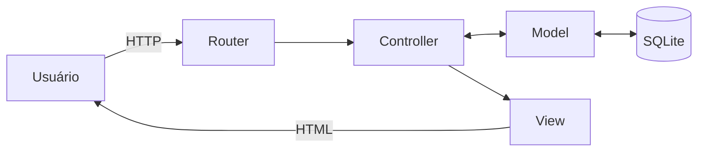
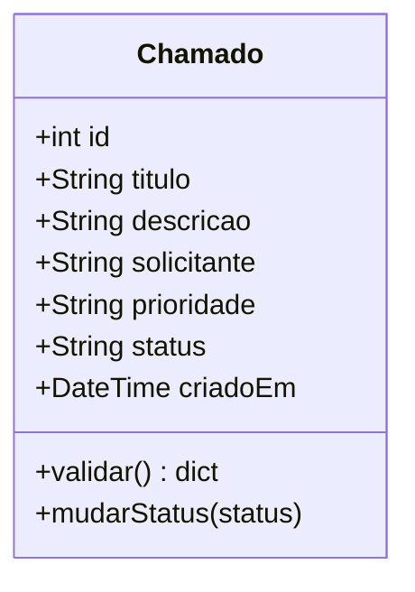

# Help Desk: Sistema de Controle de Chamados
Projeto Integrador Transdisciplinar em Engenharia de Software II.

**Stack:** Python 3 · Flask (MVC) · SQLite · HTML/CSS (Jinja) · pytest

## Como executar
```bash
python -m venv .venv && source .venv/bin/activate   # Windows: .venv\Scripts\activate
pip install -r requirements.txt
python run.py          # http://127.0.0.1:5000
pytest -v              # testes
```

## Arquitetura MVC
| Camada | Arquivo | Responsabilidade |
|---|---|---|
| Model | `app/models.py`, `schema.sql` | Regras de validação e acesso ao banco |
| View | `app/templates/`, `app/static/` | Telas HTML/CSS |
| Controller | `app/controllers.py` | Rotas, fluxo e mensagens |



## Requisitos
- **RF01** Abrir chamado · **RF02** Listar e filtrar por status · **RF03** Editar · **RF04** Alterar status · **RF05** Excluir
- **RNF01** Usabilidade (mensagens claras, confirmação ao excluir) · **RNF02** Validação de entrada · **RNF03** Manutenibilidade (MVC + testes)

## Diagrama de classes (UML)


## Dicionário de dados: tabela `chamado`
| Coluna | Tipo | Nulo | Domínio / regra |
|---|---|---|---|
| id | INTEGER | não | PK, autoincremento |
| titulo | VARCHAR(100) | não | texto não vazio |
| descricao | TEXT | não | texto não vazio |
| solicitante | VARCHAR(80) | não | texto não vazio |
| prioridade | VARCHAR(10) | não | {baixa, media, alta} (CHECK) |
| status | VARCHAR(15) | não | {aberto, em_andamento, resolvido}; padrão `aberto` |
| criado_em | DATETIME | não | padrão `CURRENT_TIMESTAMP` |

DDL em `schema.sql`. Modelo lógico normalizado (3FN): uma única entidade, sem dependências transitivas.

## Testes (verificação e validação)
- **Unitários (Model):** validação de campos, CRUD, status inválido.
- **Integração/sistema (HTTP):** criação, erro tratado (400), 404, fluxo de status e exclusão.
- **Aceitação:** `docs/template_teste.md`, aplicado por 5 colegas.

## Estrutura do Git sugerida
`situacao1/` (documentação, UML, protótipo) · `situacao2/` (código) · `situacao3/` (formulários, vídeo, correções)
